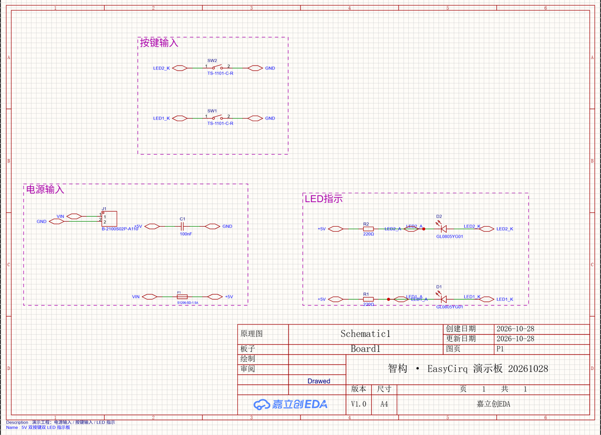
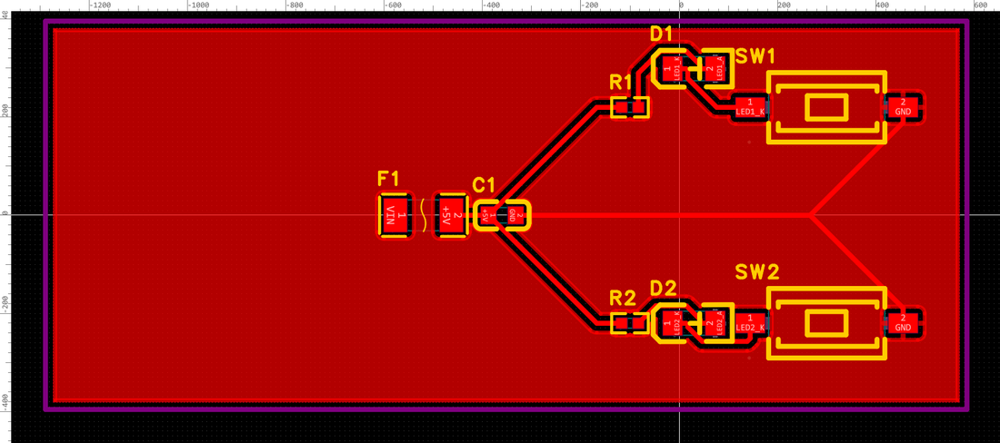
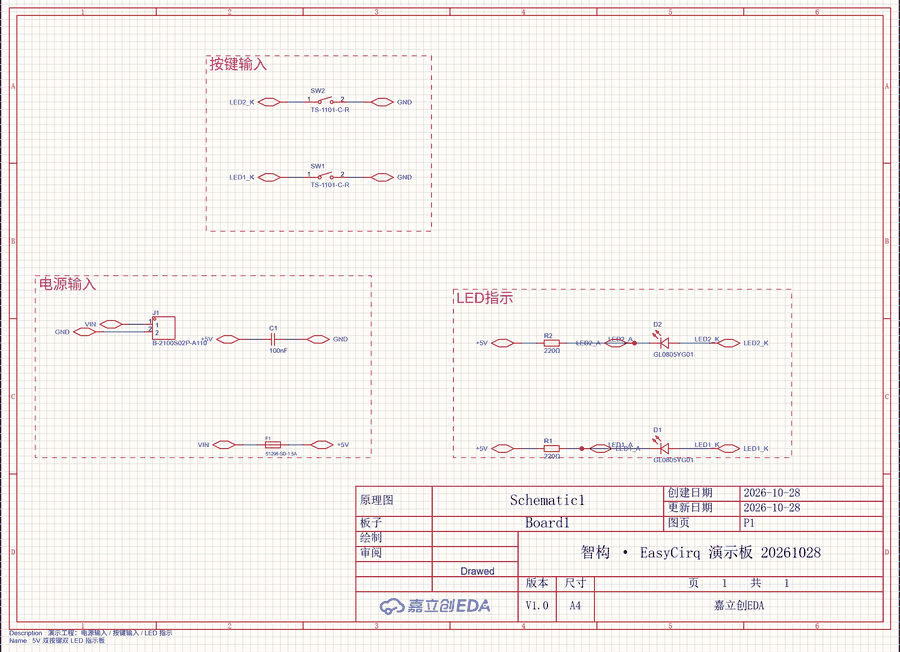

# EasyCirq Connector (EasyEDA Pro extension)

> 中文版：[README.md](https://github.com/zsx3896926/EasyCirq/blob/main/connector/README.md)
>
> In one sentence: **it is a local "network cable"** — it turns the EDA operations that the AI
> requests on your machine into official EasyEDA Pro API calls. Everything happens locally;
> nothing goes through the cloud.

For everyone: first-time installers, daily users, troubleshooters and developers.

---


## Demo

The screenshots below come from this project's real board (a 5V dual-button dual-LED
indicator generated by 智构 · EasyCirq):



[View the schematic on GitHub](https://github.com/zsx3896926/EasyCirq/blob/main/connector/images/showcase-schematic.png)



[View the PCB render on GitHub](https://github.com/zsx3896926/EasyCirq/blob/main/connector/images/showcase-pcb.png)



[View the demo GIF on GitHub](https://github.com/zsx3896926/EasyCirq/blob/main/connector/images/showcase.gif)

- Both the schematic and the PCB were drawn inside EasyEDA Pro through this connector;
- PCB check passed (0 DRC violations), a 6-line orderable BOM, Gerber/drill/CPL exported;
- The GIF walks through schematic -> PCB from the same project.


## 1. What it is (and is not)

| Is | Is not |
|---|---|
| An extension (`.eext`) installed inside EasyEDA Pro | Not standalone software, no desktop icon |
| Translates requests from the local **EasyCirq runtime** into official `eda.*` API calls | Contains no AI and generates no designs |
| Connects only to the local loopback `127.0.0.1:23111-23120` | No internet, no project upload, no telemetry, no account |
| Requires you to explicitly grant **"Allow external interaction"** | Never modifies a project silently: every step needs a request from the EasyCirq runtime |

The three layers (easy to confuse at first):

```
AI client (Claude / Codex, etc.)
   └─ EasyCirq Skill (design method, rules, gates)
        └─ EasyCirq runtime (local CLI + daemon; this is what actually sends the actions)
             └─ this connector (executes eda.* API calls inside EasyEDA)
                  └─ EasyEDA Pro (the canvas you see)
```

The connector only translates between the **bottom two layers**.

---

## 2. Prerequisites

- Windows 10/11 (tested), EasyEDA Pro **V4** (tested 4.1.78);
- The EasyCirq toolchain installed with the unified installer (default `%LOCALAPPDATA%\EasyCirq`);
- Know where the `.eext` is: run `easycirq connector path`, or look at
  `%LOCALAPPDATA%\EasyCirq\connector\easycirq-connector_v<version>.eext`.

---

## 3. Import (the only manual step)

> The extension **is loaded only when EasyEDA starts**; importing while it runs has no effect.

1. **Fully exit** EasyEDA Pro (not minimize; confirm the process is gone);
2. Start it again → **Settings → Extensions → Installed → Import extension**;
3. Choose `easycirq-connector_v<version>.eext`;
4. In the extension manager find **"EasyCirq Connector"** → open its settings/permissions →
   enable **"Allow external interaction"** (if not enabled, the connector cannot connect, and EDA does not report an error);
5. **Fully exit and restart** EasyEDA Pro;
6. Open any project and run `easycirq doctor` from the command line:
   - `connector.status = connected` → success;
   - `degraded` with "connector not connected" → re-check steps 4 and 5 (permission and restart).

> Why "external interaction": the connector talks to the local daemon through
> `eda.sys_WebSocket`, which the host blocks by default. You must allow it explicitly in the
> extension settings.

---

## 4. Daily use (you barely touch it)

- After EasyEDA Pro starts, the connector connects to the local daemon automatically; it disconnects when EDA closes;
- You just describe requirements to the AI; the AI drives `easycirq`; the connector works silently in the background;
- You do **not** need to start the connector manually every time, but the daemon must be online
  (`easycirq daemon start`, or the background service from the installer; `easycirq doctor` reports daemon status);
- With multiple EasyEDA windows open, `easycirq` will ask for `--window` or `--project` to pick the target —
  that is a guard against writing to the wrong window, not a fault.

---

## 5. Upgrade / uninstall (the upgrade flow differs from normal software)

EasyEDA identifies extensions by **UUID**: re-importing the same UUID may update the version number in
the manager while still loading old code. Therefore this connector **uses a new UUID for every release**.
The correct flow:

1. Close EasyEDA Pro;
2. Start it again → extension manager → **uninstall the old version** "EasyCirq Connector";
3. Import the new `.eext`;
4. Enable "Allow external interaction" again;
5. **Fully exit and restart** EDA;
6. `easycirq doctor` must show the connector version = expected version and status `connected`.

> Upgrade note: the installer and `easycirq doctor` show the expected connector version. If it does not match,
> follow the flow above; do not just overwrite-import (it may keep old code).
>
> Uninstall: remove the extension in the extension manager. It does not touch your projects and does not
> delete the EasyCirq toolchain.

---

## 6. Troubleshooting

| Symptom | Most likely cause | Fix |
|---|---|---|
| `easycirq doctor` shows connector not connected / windows 0 | daemon not running | `easycirq daemon start`, then retry |
| Cannot connect although the daemon is running | "External interaction" not enabled | enable it in extension settings → fully restart EDA |
| Still no connection after enabling | EDA did not really restart (process still alive) | confirm the process exited, then reopen |
| `easycirq doctor` reports a connector version mismatch | old version is loaded in EDA | uninstall old → import new → restart (see §5) |
| "Ambiguous window" errors | several EDA windows are open | use `easycirq ... --project <name>` or `--window <id>` |
| Errors like "page hidden / cannot capture" | the EDA tab is in the background, canvas not repainted | bring the EDA window to the front and retry |
| Data after an operation looks stale | runtime cache / not saved | the AI runs `save → doc reload → read back`; never trust a single return value |
| Two "EasyCirq Connector" entries in the manager | the old UUID was not uninstalled | uninstall the old one, keep only the current version |

Logs: `%USERPROFILE%\.easycirq\daemon.log` (connection/request records on the daemon side).

---

## 7. Security and privacy

- **Loopback only**: `127.0.0.1`, no public listener, no cloud relay;
- **No telemetry / no account**: the extension collects no usage data and requires no login;
- **Least privilege**: it calls an `eda.*` API only when a local EasyCirq runtime request asks for it;
- **Auditable**: every action produces structured receipts and evidence (EasyCirq runtime artifacts /
  `evidence`), and risky actions (clear page, delete, …) are confirm-gated in the runtime.

---

## 8. Version and compatibility

| Item | Current value |
|---|---|
| Extension name | `easycirq-connector` |
| Display name | EasyCirq Connector (zh: 智构 · EasyCirq 连接器) |
| Extension UUID | `ef77a1878ae54dcf88f56436ee3dc5c6` (changes with every upgrade, see §5) |
| Version | `1.0.19` |
| Required service | `easycirq-agent` |
| Ports | `127.0.0.1:23111-23120` (overridable via the extension user config `easycirqDaemonPorts`) |
| Protocol | wire `v1` (handshake / register / context / request / response / ping / pong) |
| Host requirement | EasyEDA Pro `>= 3.2.0` (tested 4.1.78) |

---

## 9. Developers: build and release rules

```bash
npm install                                # first time
npx ts-node ./config/esbuild.prod.ts        # -> dist/index.js (version constant injected at compile time)
npx ts-node ./build/packaged.ts             # -> build/dist/easycirq-connector_v<ver>.eext
npx tsc --noEmit                            # type check
```

**Hard release rules** (problems already hit — do not repeat them):

1. **Changing code requires bumping `version` in `extension.json` AND recompiling** — the version
   constant is injected at compile time; changing only the manifest yields "new version, old code";
2. **Create a new `uuid` for every release** — EasyEDA deduplicates by UUID; re-importing the same UUID
   may keep the old payload;
3. `.eext` = zip (`extension.json` + `dist/index.js` + `images/` + license files);
4. The runtime's `runtime/internal/version/version.go` `ConnectorVersion` must be updated too,
   otherwise `easycirq doctor` reports a version mismatch;
5. After release, always smoke-test on a real host: import → authorize → restart → `easycirq doctor` +
   one `easycirq call`.

Sources: `docs/toolchain-integration/` (capability matrix, field lessons); upstream provenance and licenses
are recorded in `NOTICE`.

---

## Feedback & support

- **GitHub project**: https://github.com/zsx3896926/EasyCirq
- **Issues** (recommended): https://github.com/zsx3896926/EasyCirq/issues
- **Email**: 3896296@qq.com
- **Changelog**: `connector/CHANGELOG.md` in the repository

## 10. License

- This extension release is distributed under **Apache-2.0** (the project's main license);
- Upstream `easyeda-agent` connector code is MIT (Copyright (c) 2026 zhoushoujianwork and
  contributors); its copyright and permission notice is retained in `NOTICE` as MIT requires,
  and the embedded component (`src/beautify/*`) is also Apache-2.0;
- This extension is an independently maintained fork and is not an official JLC product.
