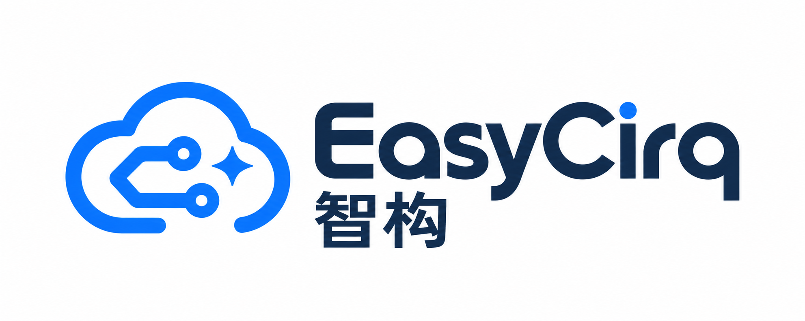

# 智构 · EasyCirq 连接器（EasyEDA Pro 扩展）

> English: [README.en.md](README.en.md)
>
> 一句话：**它是一根“本地网线”**——把 AI 在你电脑上发出的 EDA 操作请求，
> 转换成嘉立创 EDA 专业版（EasyEDA Pro）的官方 API 调用；操作只在你本机发生，不经过云端。

面向所有使用者（第一次安装的、日常使用的、排障的、改代码的）。

---

## 1. 它是什么，不是什么

| 是 | 不是 |
|---|---|
| 装在 EasyEDA Pro 里的扩展（`.eext`） | 不是独立软件，也不需要桌面图标 |
| 把本机 `zhigou` 运行时的请求翻译成官方 `eda.*` API | 不包含 AI，不生成设计 |
| 只连本机回环 `127.0.0.1:23111-23120` | 不联网、不上传工程、无遥测、无账号 |
| 需要你**明确授权**「外部交互」才工作 | 不会偷偷改工程：每一步都需 zhigou 发来请求 |

三层角色（容易混淆）：

```
AI 客户端（Claude/Codex 等）
   └─ design-hardware Skill（设计方法、规则、门禁）
        └─ zhigou 运行时（本机 CLI + daemon，真正下发动作）
             └─ 本连接器（在 EasyEDA 内部执行 eda.* API）
                  └─ EasyEDA Pro（你看到的画布）
```

本连接器只负责**最底下两层之间**的翻译。

---

## 2. 安装前提

- Windows 10/11（已实测），EasyEDA Pro **V4**（实测 4.1.78）；
- 已用统一安装器装好 zhigou 工具链（默认 `%LOCALAPPDATA%\Zhigou`）；
- 知道 `.eext` 在哪：命令行运行 `zhigou connector path`，或直接看
  `%LOCALAPPDATA%\Zhigou\connector\zhigou-connector_v<版本>.eext`。

---

## 3. 导入（唯一一次人工步骤）

> 扩展**只在 EasyEDA 启动时加载**，运行中导入不生效。

1. **完全关闭** EasyEDA Pro（不是最小化；确认进程退出）；
2. 重新打开 → **设置 → 扩展 → 已安装 → 导入扩展**；
3. 选择 `zhigou-connector_v<版本>.eext`；
4. 扩展管理器里找到 **「智构 · EasyCirq 连接器」** → 打开设置/权限 → 勾选
   **「允许外部交互 / Allow external interaction」**（不勾选则连不上，而且 EDA 通常不会提示错误）；
5. **完全退出并重新启动** EasyEDA Pro；
6. 打开任意工程，命令行运行 `zhigou doctor`：
   - 看到 `connector.status = connected` → 成功；
   - 看到 `degraded` 且提示连接器未连接 → 回到第 4/5 步检查权限与重启。

> 为什么要「外部交互」：连接器通过 `eda.sys_WebSocket` 与本机 daemon 通信，宿主默认禁止，
> 必须由你在扩展设置里显式放行。

---

## 4. 日常使用（几乎不用管它）

- 打开 EasyEDA Pro 后连接器自动连上本机 daemon；关闭 EDA 自动断开；
- 你只需要对 AI 说需求，由 AI 调用 `zhigou`；连接器在你无感的情况下执行；
- **不需要**每次手动启动连接器；但 daemon 必须在线（用 `zhigou daemon start` 启动，或使用安装器注册的
  后台服务；`zhigou doctor` 会显示 daemon 是否在运行）。
- 若同时开着多个 EasyEDA 窗口，`zhigou` 会要求用 `--window` 或 `--project` 指定目标——
  这是防止写错窗口的保护，不是故障。

---

## 5. 升级 / 卸载（重要，升级流程与普通软件不同）

EasyEDA 按**扩展 UUID** 识别插件：同 UUID 重新导入时，管理器会更新版本号但可能仍加载旧代码。
因此本连接器**每次升级都换新 UUID**，正确流程是：

1. 关闭 EasyEDA Pro；
2. 重新打开 → 扩展管理器 → **先卸载旧版本**「智构 · EasyCirq 连接器」；
3. 导入新 `.eext`；
4. 重新勾选「允许外部交互」；
5. **完全退出并重启** EDA；
6. `zhigou doctor` 确认 `connector` 版本 = 期望版本、状态 `connected`。

> 升级提示：安装器/`zhigou doctor` 会显示期望的连接器版本；版本不匹配时按上面流程处理，
> 不要直接覆盖导入（可能保留旧代码）。
>
> 卸载：扩展管理器移除该扩展即可；卸载不会动你的工程文件，也不会删除 zhigou。

---

## 6. 故障排查

| 症状 | 最可能原因 | 处理 |
|---|---|---|
| `zhigou doctor` 显示 `connector 未连接` / `windows 0` | daemon 未启动 | 运行 `zhigou daemon start`，再试 |
| 连不上、但 daemon 正常 | 没勾「外部交互」 | 扩展设置里勾选 → 完全重启 EDA |
| 勾了权限仍连不上 | EDA 没真正重启（进程还在） | 确认进程退出后重开 |
| `zhigou doctor` 提示连接器版本不符 | EDA 里是旧版本 | 卸载旧版 → 导入新版 → 重启（见 §5） |
| 多窗口或报窗口歧义 | 同时开了多个 EDA 窗口 | 用 `zhigou ... --project <工程名>` 或 `--window <id>` 指定 |
| 操作报「页面隐藏/无法截图」类错误 | EDA 页签在后台，画布未重绘 | 把 EDA 窗口切到前台，再重试 |
| 操作后读回的数据像未生效的 | 运行时缓存/未保存 | AI 会走 `save → doc reload → 回读`；不要只看一次返回值 |
| 扩展管理器里有两个「智构 · EasyCirq 连接器」 | 旧 UUID 未卸载 | 卸载旧的，只留当前版本 |

日志位置：`%USERPROFILE%\.zhigou\daemon.log`（daemon 侧连接/请求记录）。

---

## 7. 安全与隐私

- **仅本机回环**：`127.0.0.1`，不监听公网；无云端中转；
- **无遥测/无账号**：扩展不收集使用数据，不需要登录；
- **权限最小化**：仅在收到本机 zhigou 的请求时调用对应 `eda.*` API；
- **可审计**：所有动作都有结构化回执与证据（`zhigou` 的 artifacts / evidence），
  且高风险动作（清空页面、删除等）在运行时侧有确认门控。

---

## 8. 版本与兼容

| 项 | 当前值 |
|---|---|
| 扩展名 | `zhigou-easycirq-connector` |
| 显示名 | 智构 · EasyCirq 连接器 |
| 扩展 UUID | `f7880f9da65f42ba8fe657711003c927`（每次升级会换新，见 §5） |
| 版本 | `1.0.2` |
| 依赖服务 | `zhigou-agent`（本工具链 daemon；**不连**旧 `easyeda-agent`） |
| 端口 | `127.0.0.1:23111-23120`（可用扩展用户配置 `zhigouDaemonPorts` 覆盖） |
| 协议 | wire `v1`（handshake / register / context / request / response / ping / pong） |
| 宿主要求 | EasyEDA Pro `>= 3.2.0`（实测 4.1.78） |

---

## 9. 开发者：构建与发版规则

```bash
npm install                                # 首次
npx ts-node ./config/esbuild.prod.ts        # -> dist/index.js（编译期注入版本常量）
npx ts-node ./build/packaged.ts             # -> build/dist/zhigou-connector_v<ver>.eext
npx tsc --noEmit                            # 类型检查
```

**发版硬规则**（踩过的坑，别再踩）：

1. **改代码必须 bump `extension.json` 的 `version` 并重新编译**——版本常量是编译期注入的，
   只改 manifest 不重编译会得到"版本号变了、代码没变"的包；
2. **每次发版换新 `uuid`**——EasyEDA 按 UUID 去重，同 UUID 重导入可能保留旧 payload；
3. `.eext` = zip（`extension.json` + `dist/index.js` + `images/` + 许可证）；
4. 运行时侧 `runtime/internal/version/version.go` 的 `ConnectorVersion` 必须同步，
   否则 `zhigou doctor` 会报版本不匹配；
5. 发布后务必真机验证：导入 → 授权 → 重启 → `zhigou doctor` + 一个 `zhigou call` 冒烟测试。

规则来源：`docs/toolchain-integration/`（能力矩阵、现场教训）；上游 fork 与许可证见 `NOTICE`。

---

## 10. 许可

- 本扩展发布物按 **Apache-2.0**（本项目主许可）分发；
- 上游 `easyeda-agent` 连接器代码为 MIT（Copyright (c) 2026 zhoushoujianwork and contributors），
  其版权与许可声明按 MIT 要求保留在 `NOTICE` 中；内嵌组件（`src/beautify/*`）同为 Apache-2.0；
- 本扩展是独立维护的分支，非嘉立创官方产品。
