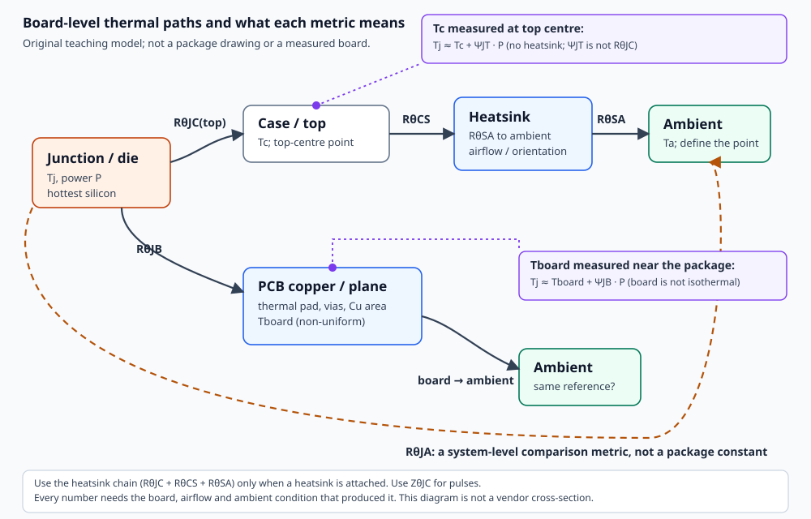

# 板级热设计：从功耗到结温、PCB 散热路径与验证

> 按需加载的热设计专题。它补充现有 `power.md`、`pcb-placement-details.md`（PL16）、`manufacturing-details.md`（MF05）和 `part-selection.md` 中一行式的热提示，不替代对应电气/制造检查。
>
> 本专题把“热”拆成五件事：**功耗预算 → 热阻指标选择 → 稳态/瞬态结温 → PCB 与外壳路径 → 测量验证**。每一节都说明适用条件、为什么、怎么做、怎么判定和例外。
>
> 证据标记：`[S01]` 等指向 [热来源](sources.md) 的实际查阅记录；标“推导”的公式是本专题的一阶模型；标“假设”的数值不是器件保证值。没有实际做过的 EDA、仿真或测量，在本专题及交付记录中保持未验证。



## 目录

- 0. 什么时候必须做热核算
- 1. 五个入口问题
- 2. 热阻指标：能用什么、不能用什么
- 3. 功耗预算：先算 P，再谈热阻
- 4. 稳态结温：三条路径
- 5. 瞬态与脉冲
- 6. PCB 热路径
- 7. 外壳与系统
- 8. 验证：测量什么、怎么测、能证明什么
- 9. Agent 工作流
- 10. 例外与红 flags
- 11. 工具与算例
- 附录 A：可引用的定量锚点（按来源条件）

## 0. 什么时候必须做热核算

### 0.1 适用条件

出现下列任一情况，不能只写“加了散热焊盘”就放行：

- 器件有持续功耗，且封装小、铜面积小、无风或装在封闭外壳内。
- LDO、线性稳压器、线性模式 MOSFET、分流电阻、LED、功放、继电器线圈等以热为主要失效机理的器件。
- 开关电源的 MOSFET、二极管、电感、采样电阻；尤其是高输入电压、高开关频率、大占空比或短路/启动瞬态。
- 处理器、FPGA、SoC、DDR、PHY 等电流随负载/频率变化的器件；数据手册的“典型功耗”不足以做最坏工况。
- 器件 Tj,max、Tc,max、推荐工作温度与预计工作点接近；或 datasheet 只给了 JEDEC 测试板上的 RθJA，而实际板明显不同。
- 密封外壳、高环境温度、高海拔、低气流、邻近热源、用户可触摸表面、电池附近、温度传感器附近。
- 用户问“能不能用这个封装”“要不要加散热片”“铜要多宽”“过孔要几个”“会不会烫”“电池会不会热”。

### 0.2 不能替代什么

本专题不能替代：具体型号的 datasheet/勘误、项目安全/可靠性标准、IC 内部热仿真、板级 FEM/CFD、实际温升测量、安规认证、长期寿命评估。它给出的是**可复核的筛查和设计决策**，不是保证值。电池热、触摸温度、风扇/热管、热仿真、TIM/隔热材料、CTE/热机械等超出本专题深度，见 7.6 的交接条件。

### 0.3 快速触发规则（项目可改）

- 估算 Tj 与 Tj,max 的余量小于项目规定值（例如 20 K，只是示例）→ 做完整核算与实测计划。
- 估算所用的 RθJA 来自 JEDEC 测试板，而实际 PCB 的铜面积、层数、气流、外壳明显不同 → 不能把它当实际值；按第 2、6 节改用 ΨJT/ΨJB、RθJA(effective) 或散热器链，并安排测量。
- 只有“典型功耗”而没有最坏工况 → 先补最坏工况，再算。
- 器件有脉冲/启动/短路电流 → 除稳态外，按第 5 节检查 ZθJC。
- 外壳密封且总功耗 > 1 W（示例阈值，不是标准）→ 按第 7 节做外壳表面预算；阈值应按外壳尺寸、材料和允许温升调整。

## 1. 五个入口问题

在选封装、画铜皮或买散热器之前，先回答这五个问题。缺哪个，就在结论里标“待确认”，不要用典型值悄悄补齐。

| 问题 | 为什么必须先答 | 缺失时怎么办 |
|---|---|---|
| 1. 热源是谁，最坏功耗多少？ | 热设计的输入是 P，不是“大概不热”。最坏工况可能出现在高压差、满载、短路、启动、低效轻载或高温时。 | 从 datasheet 的 max 值、效率曲线、负载曲线、实测电流估算；给范围并标假设。 |
| 2. 限值是什么？ | Tj,max（绝对最大）、推荐工作 Tj、Tc,max、触摸温度、电池温度、传感器温度不是同一个限值。[S01] | 查具体型号的绝对最大额定值和推荐工作条件；区分“功能正常”和“不损坏”。 |
| 3. 环境是什么？ | Ta 的测点因标准/系统而异（进风口、器件下方、板前空气）；外壳、气流、海拔、邻热源都会改变结果。[S01] | 写明 Ta 的定义和测点；没有外壳/气流信息时给条件结论，不写“通过”。 |
| 4. 热从哪里走？ | 顶部、底部、热焊盘、PCB 铜、过孔、散热器、外壳是不同的路径；用错指标会得到完全错误的结果。[S01][S04] | 读封装/布局指南，确认主路径；没有资料时按最保守路径估算并标待核。 |
| 5. 稳态还是瞬态？ | 稳态用 Rθ；脉冲/启动/短路用 Zθ(t)；平均功耗和峰值功耗不是一回事。[S01][S08] | 先算稳态；有脉冲/故障工况时补瞬态。 |

## 2. 热阻指标：能用什么、不能用什么

### 2.1 一张选择表

| 指标 | 它是什么 | 什么时候能用 | 什么时候不能用 | 必须附带的条件 |
|---|---|---|---|---|
| `RθJA` | 封装在**特定测试板**上的结到环境热阻；本质是封装比较指标。[S01] | 早期封装筛选；两家厂商用同一 JEDEC 方法报告时的相对比较；已知系统 `RθJA(effective)` 时做 Tj 估算。[S01] | 把 datasheet 的 JEDEC 板数值直接当实际板 Tj 预测；实际铜面积/层数/气流/外壳与测试板不同。[S01] | 测试板类型（1s/2s2p 等）、铜面积、层数、气流、Ta 测点、功耗。 |
| `RθJA(effective)` | 器件在**你的系统**中的等效结到环境热阻。[S01] | 已通过热模型或系统测量得到该值，且周围器件功耗不变。[S01] | 用别的板/外壳/气流的值冒充；没有定义系统条件。[S01] | 系统板、外壳、气流、邻热源、Ta 测点。 |
| `RθJC` | 结到封装外壳**指定参考面**的热阻（top 或 bottom；外露焊盘路径常称 θJP）。[S01][S02] | 有散热器/冷板，或外露焊盘是主路径，且热量主要从该参考面走；`RθJC << RθJA` 时。[S01][S02] | 不写 top/bottom、把顶部塑料壳温套到外露焊盘路径；或反推无散热器塑料封装 Tj。[S01] | 参考面（top/bottom/pad）、测点、散热器/TIM、安装压力、焊接/接触面积。 |
| `ΨJT` | 结到封装顶部的**表征参数**，不是真热阻；用顶部壳温反推 Tj。[S01] | 无散热器，测顶部中心温度；`Tj ≈ Tc + ΨJT·P`。[S01] | 加散热器时；把 ΨJT 当 RθJC；用粗热电偶测壳温。[S01] | 测点（顶部中心）、板/气流条件（ΨJT 随它们变）。[S01] |
| `ΨJB` / `RθJB` | 结到板/引脚的表征参数或热阻；板温不是均匀单点。[S01] | 测板温反推 Tj；`Tj ≈ Tboard + ΨJB·P`。[S01] | 把 PCB 当等温体；用远离器件的板温；忽略多热源。[S01] | 板温测点、铜结构、邻热源。 |
| `ZθJC(t)` / `ZθJA(t)` | 瞬态热阻抗；按脉冲宽度和占空比归一化。[S01][S08] | 单脉冲/重复脉冲/启动/短路；归一化ZJC乘RθJC并叠加对应Tc；归一化ZJA乘RθJA并叠加对应Ta；绝对K/W阻抗直接乘P，不能再乘热阻。[S08] | 稳态；超出 datasheet 曲线范围外推；忽略测试板条件。[S08] | 脉冲宽度、占空比、测试板、Tc 假设。 |

### 2.2 为什么 RθJA 不能直接拿来算实际板

TI 的原文说得很直接：RθJA 是最常被误用的指标；它是在特定测试 coupon 上测的，测试板本身就是散热器；在静止空气 JEDEC 测量中，**70%–95% 的芯片功率从测试板散出**，不是从封装表面。[S01] 同一封装换测试板，RθJA 可差很多：

- 1s 与 2s2p 测试板之间，某些封装可差到 **50%**。[S01]
- 芯片/焊盘尺寸变化，CSP 的 RθJA 可变化近 **8 倍**。[S01]
- PCB 设计对 RθJA 的影响被 TI 标为“强（100%）”，芯片/焊盘尺寸 50%，封装内部几何 35%，海拔 18%，环境温度 7%，功耗 3%。[S01]
- 海拔 8000 ft 约热 20%；TI 引用 IBM 的倍率：3000 ft 1.1、5000 ft 1.14、7000 ft 1.17、8350 ft 1.2。[S01]
- 环境温度从 0°C 到 100°C，RθJA 可改善约 10%–20%；很低功耗时 RθJA 可能比额定功率时高 2–3 倍。[S01]

所以：

- datasheet 的 RθJA 可以作为**封装比较**或**保守筛查**，但不能当“我的板就是这个值”，也不保证一定是实际值的上界（见下面的实测反例）。
- 如果要用它算实际 Tj，必须把实际板/外壳/气流条件代入，得到 `RθJA(effective)`，并写明条件。[S01]
- 更稳的做法是：用 ΨJT/ΨJB 配合实测壳温/板温，或用散热器链，或做实际温升测量。

SLVAE85A 对三种 LDO 的实测可以给出量级（4 层、9 in²、外层 2 oz/内层 1 oz、静止空气；[S05]）：

| 器件/封装 | datasheet θJA | 1S0P 最差板 | JEDEC High-K 近似 | 热增强布局 | 热饱和布局 |
|---|---:|---:|---:|---:|---:|
| TPS745 WSON | 80.3 | 169.2 | 61.3 | 46.8 | 43.2 °C/W |
| TPS7B82-Q1 TO-252 | 38.8 | 91.2 | 31.9 | 26.8 | 26.3 °C/W |
| TLV755P SOT-23 | 231 | 227 | 155 | 108 | 104 °C/W |

这组数据同时说明两件事：**同一器件换板，θJA 可以差 2–4 倍**；**datasheet 值不一定是上界**——这三个例子里实测 High-K 近似值都低于 datasheet 值，作者没有解释差异。因此“datasheet 保守”只能作为观察，不能当通用保证；实际板必须按自己的铜/层/气流核对。[S05]

**方法注：** SLVAE85 的 θJA 不是直接结温测量，而是用“热关断阈值–功耗斜率”间接得到的；作者明确说精度受烤箱 ±2°C、环境温度/功耗漂移、Vout 随温度下降导致功耗增加的限制（作者称“slight expense of accuracy”）。这些值适合看相对趋势，不应当作直接结温测量或精确绝对热阻。[S05]

### 2.3 为什么“壳温 + RθJC”经常错

`Tj = Tc + RθJC·P` 只假设全部热量从壳面走。对现代塑料封装，60%–95% 的热从 PCB 走，这个假设不成立；按它算出的 Tj 通常偏高（把 PCB 路径漏掉）。[S01] 但要注意：如果壳温本身被粗热电偶测低，误差可能抵消甚至反号；所以不能靠这个公式“双向修正”。TI 明确说这是 RθJC 的传统但无效用法，应由 ΨJT 取代。[S01]

**外露焊盘（QFN/DFN/PowerPAD 等）的参考面要单独看。** `RθJC(bottom)`/`θJP` 的参考点是焊盘/封装底面，不是顶部塑料壳。若焊盘是主热路径、焊接完整，并且能在规定参考点测得 `Tc(pad)`（或按厂商的 θJP 测法），则 `Tj ≈ Tc(pad) + RθJC(bottom)·P` 可以成立；把**顶部**壳温代进 **bottom** θJC 则是另一类错误。不要因为“RθJC 不能配壳温用”就否定所有 bottom θJC/θJP 数据；先确认参考面、测点和主路径。[S01][S02][S03][S26]

只有在**真的加了高效散热器**、且 RθJC 远小于 RθJA 时，才用：

```text
Tj = Ta + P · (RθJC + RθCS + RθSA)          （一阶串联模型）
```

其中 RθCS 是壳到散热器的界面热阻，RθSA 是散热器到环境的热阻；Ta 是 RθSA 表征时用的环境温度，通常离散热器一段距离。[S01] 如果已知系统的 RθJA，TI 给出更准确的并联/网络近似（Eq.6），但工程上先确认“散热器是否真的主导”。[S01]

### 2.4 ΨJT 和 ΨJB 的正确用法

- `Tj ≈ Tc + ΨJT·P`：Tc 是封装顶部中心温度；ΨJT 不是热阻，测量时假设全部功率从顶部走，但实验条件接近实际应用，所以反推 Tj 很实用。[S01]
- 塑料封装 ΨJT 典型 0.5–2°C/W，而 RθJC 典型 4–15°C/W；薄封装更小，带热沉的封装接近 0。[S01]
- ΨJT 随板结构和气流变化（TI 表 3-1 给出 128-pin TQFP 在不同板/气流下的 0.09–0.47°C/W）。[S01]
- 加散热器时不要用 ΨJT，改用散热器链。[S01]
- `Tj ≈ Tboard + ΨJB·P`：PCB 散掉 75%–95% 的热，所以 ΨJB 接近 RθJB；但板温不是均匀单点，测点要按指南。[S01]
- 测量细节：36–40 AWG 热电偶、珠径 ≤2×2 mm、沿对角线走线并在 PCB 上贴 25 mm 以上；粗线可使温差低估 50% 以上，误差可达 5%–50%。[S01]

### 2.5 三电阻模型与“什么时候用哪个”

TI 的三电阻近似（Figure 4-1）：结到壳 `RθJC`、结到板 `RθJB`、壳到环境 `Rθa`。[S01] 它不是精确网络，但能帮助判断主路径：

- 板主导（大多数塑料封装、无散热器）：优先 ΨJB/板温，或系统 `RθJA(effective)`；不要用顶部壳温 + 顶部 RθJC。
- 外露焊盘/PCB 主导：可用 bottom `RθJC`/`θJP` + 焊盘参考点温度，前提是焊接完整、参考面/测点一致；不要用顶部壳温替焊盘温度。
- 顶部散热器主导：用 `RθJC(top) + RθCS + RθSA`；确认散热器真的覆盖了主要热面。
- 顶部小壳温测量：用 ΨJT；不要加散热器。
- 瞬态：用 ZθJC(t)；稳态 Rθ 不适用于短脉冲。

### 2.6 常见误用清单

- 把 datasheet 的 JEDEC RθJA 直接乘实际功耗，得到“Tj”，不写板/气流条件。[S01]
- 用壳温 + RθJC 反推无散热器塑料封装的 Tj。[S01]
- 把 ΨJT 当 RθJC，或加散热器后还用 ΨJT。[S01]
- 用粗热电偶测壳温，读数被热电偶导走。[S01]
- 用红外枪测光亮金属壳，未做发射率修正。[S01]
- 把“环境温度”当成“器件附近的空气温度”，不说明测点。[S01]
- 用 25°C 的 RθJA 去算 85°C 环境，忽略 RθJA 随温度/功耗变化。[S01]
- 把某个封装的 RθJA 数值推广到同封装的其他芯片；die size、内部几何、焊盘都不同。[S01]

## 3. 功耗预算：先算 P，再谈热阻

热阻只是分母；分子 P 算错，后面全错。以下公式都要用**最坏工况**，并注明是平均、RMS 还是峰值。

### 3.1 LDO / 线性稳压器

```text
P ≈ (Vin − Vout) · Iout + Vin · Iq
```

- 适用：线性工作，压差为正；Iq 取最坏相关工况的 max 值。
- 为什么：调整管承受全部压差；负载电流全部流过调整管。
- 常见错误：只算 `(Vin−Vout)·Iout` 漏掉 Iq；用典型 Iq；忽略 Vin 最高、Iout 最大、轻载高 Iq 的不同角落；把 LDO 的效率当成开关电源。
- 判定：P 乘热阻链得到 Tj；如果 Tj 超限，优先改拓扑（Buck）、降 Vin、加散热/铜，而不是只换大封装。
- 例外：低 Vin−Vout、低 Iout、低 Iq 时 P 很小，可按第 0.3 节简化；但不要跳过“最坏 Vin/Iout”检查。
- 例子：TI SSZT950 用 TPS732 算过 5.5 V→3 V/250 mA、Iq=0.95 mA，P=0.63 W，**Ta=25°C**；SOT-23（205.9°C/W）得 Tj≈154.7°C，SOT-223（53.1°C/W）得 58.45°C。这是该器件/数据手册条件的对比示例（测试板未注明；算式取 Ta=25°C），不是实际板/外壳结果；测点和板条件不同，数值会变。[S07]

### 3.2 Buck / Boost / 开关电源

开关电源的损耗不是 `(Vin−Vout)·Iout`。至少分：

- 开关管导通损耗：`I²·Rds(on)(Tj)·D`（高侧/低侧分别算）。
- 开关损耗：硬开关近似 `0.5·Vin·Iout·(tr+tf)·fsw`（一阶线性重叠估算（不保证涵盖Coss、Qrr及振铃损耗））；感性负载在 ZCS 下开通可能很小，关断用 `0.5·Vds·Id·tf/T`；最可靠的是用 datasheet 的 `Eon/Eoff` 乘 `fsw`。[S09]
- 栅极驱动损耗：`Qg·Vgs·fsw`。
- 输出电容/Coss 损耗、死区/体二极管损耗、驱动 IC 损耗。
- 电感 DCR/磁芯损耗、采样电阻损耗、控制器静态功耗。
- 输入/输出电容 ESR 损耗。

工程做法：先用控制器/功率器件 datasheet 的效率曲线或损耗表，核对测试条件（Vin、Vout、Iout、fsw、电感、温度）；没有曲线时用上述分项估算，并标“一阶估算”。[S09] 不要用“效率 90%”一个数代替全部工况；轻载、高压差、高 fsw 时效率可能差很多。

### 3.3 MOSFET / 功率开关

```text
P_cond = I²_RMS · Rds(on)(Tj)
P_sw   ≈ 0.5 · Vds · Id · (tr + tf) · fsw        （硬开关、线性重叠的一阶线性重叠估算（不保证涵盖Coss、Qrr及振铃损耗））
P_gate = Qg · Vgs · fsw
P_total ≈ P_cond + P_sw + P_gate + P_Coss + P_diode
```

- Rds(on) 必须用**实际 Vgs 和实际 Tj** 下的值；datasheet 的 25°C 值通常偏小。[S09]
- 温度修正：用 datasheet 的 Rds(on)–Tj 曲线或归一化系数；不要用一个通用温度系数套所有 MOSFET。手册没有曲线时，用 max 值 + 保守假设，并标待核。
- 开关损耗：公式依赖负载性质（阻性/感性）、tr/tf 定义、测试条件；ST 明确说公式法不能预测真实参数，正确做法是测 Eon/Eoff。[S09] 所以把公式结果当筛查，不当保证。
- 例外：软开关/谐振拓扑、ZCS/ZVS、GaN/SiC、并联均流、雪崩/短路，需要厂商模型和实测，不能用上面的简式。

### 3.4 分流电阻、保险丝、无源件

```text
P_shunt = I² · R
```

- 用 max 电流的 RMS 值；脉冲用 I²t 或厂商脉冲曲线。
- 电阻的额定功率随环境温度降额；降额曲线按具体系列/封装/工艺，不同厂商不能互套。[S13][S14]
- SMD 电阻与通孔电阻的散热路径不同：Vishay 指出通孔轴向电阻约 80%–90% 的热经空气对流，SMD 可有多达 90% 的热经 PCB 传导；因此不能把通孔的环境降额曲线直接套到 SMD。[S13]
- 额定温度通常是 +70°C，典型降额到 +125°C 为 0；具体产品可能不同，必须查 datasheet 曲线。[S14]
- 脉冲：连续脉冲串的承受能力远低于单脉冲；至少同时检查平均功率 ≤ 该温度下的额定功率、峰值功率/电压不超过 datasheet 脉冲图、脉冲后的阻值变化在允许范围。[S15][S17]
- 端子降额/热阻：`Rth=(T_hotspot−T_terminal)/P`；例如 Vishay WSLF2512 0.5 mΩ 的 6.7°C/W 是特定型号/阻值，不能套到其他电阻。[S13]
- Vishay 50512 的两段式热分析：以焊点为界，元件内部（膜到焊点）和板/散热段分别算允许功率，取小值；其算例的 1.2/0.2/2/0.2/0.1°C/W、250/100/65°C 都是假设值，不是产品参数。[S16]
- 例外：脉冲/浪涌用平均功率会严重低估；按厂商脉冲/能量曲线；保险丝还要看 I²t 与动作时间，不是只看额定电流。

### 3.5 LED

LED 的热预算有两种口径，不能混：

```text
P_elec = Vf · If
P_heat = P_elec − P_opt = P_elec · (1 − η_opt)
Tj = T_solder + P_heat · Rth_JS_real
```

- `Rth_JS_real` 用“真实热阻”（扣掉光功率）；`Rth_JS_elec` 用全部电功率。OSRAM 明确区分两者，并给出典型光效 25%–50% 的量级；混用会得到错误 Tj。[S12]
- Cree 的**保守**估算取 `Pt = 0.75·Vf·If`（75% 电功率为热）；该文估计蓝/白 XLamp 实际约 50%–60% 输入功率变热，25% 是保守假设，不是所有 LED 的通用效率。[S10]
- Cree 的 `Tj = TSP + Θth·Ptotal` 用全部输入功率，偏保守；如果用手册的 real Rth，则应用 P_heat。[S10][S12]
- 先查具体 LED 的 Rth_JS（junction-to-solder-point）和允许的 TSP/Tj；不要拿“LED 一般 150°C”套所有产品。[S10]
- 光学效率、Vf、Rth 都随温度和电流变化；用 datasheet 曲线，不用单点典型值。
- OSRAM 的 datasheet 会给 typ/max real Rth_JS、typ/max electrical Rth_JS（max=typ+6σ）和典型光效；用 max 值做最坏估算。[S12]

### 3.6 处理器、FPGA、SoC、数据转换器

- 功耗随频率、负载、外设、IO 翻转、温度变化；datasheet 的“典型”不是最坏。[S04]
- 用厂商功耗估算工具/参考设计的最大工况；没有时给范围，并做灵敏度。
- 数据转换器的功耗还随采样率、输出负载、时钟变化；ADI 的 AD9245（380 mW）、AD9430（1.5 W）、AD6645（1.75 W）是**不同转换器**的量级，AD9777 则在同一器件上随 fDAC/fDATA/调制/PLL 从 380 mW 变到 1.75 W——说明不能用单点典型值。[S04]
- 例外：DVFS/低功耗模式、突发负载、启动峰值；按实际固件/配置测。

### 3.7 最坏工况组合

不要只算“所有典型值”。至少检查：

- Vin 最大 × Iout 最大 × Ta 最大 × 效率最低 × 气流最差。
- 启动/短路/热插拔/电机堵转等瞬态。
- 多热源同时工作，且外壳最不利（密封、无风、阳光、邻近热源）。
- 最坏装配变体（无散热器、无铜皮、无风、DNP 散热件）。

## 4. 稳态结温：三条路径

### 4.1 先选路径

```text
板主导（无散热器）:  Tj ≈ Tboard + ΨJB·P     或  Tj ≈ Ta + RθJA(effective)·P
顶部壳温（无散热器）: Tj ≈ Tc + ΨJT·P
散热器主导:          Tj ≈ Ta + P·(RθJC + RθCS + RθSA)
```

- 选哪条取决于**主要热路径**，不是哪条公式看起来方便。[S01] 公式中的 Ta 必须与所用 Rθ 的参考环境一致；测点定义见 7.1。
- 对大多数塑料封装、没有散热器的板，板路径通常主导；用 ΨJB/板温更接近实际。[S01]
- 有散热器且 RθJC 远小于 RθJA 时，用串联链；否则 TI 的 Eq.6 更合适，但需要系统 RθJA。[S01]
- 如果只能拿到 JEDEC RθJA，把它当**比较/筛查**（不保证是上界），并明确“实际板可能更低或更高”；工程上常用它做保守筛查，但不能宣称实测通过。[S01][S05]
- **判定纪律：** 用 JEDEC 测试板 RθJA 作为输入时，结论最多只能是“有条件通过”，不能判“计算通过”；除非实际板/外壳/气流条件与测试板等价，或已用系统模型/实测得到 `RθJA(effective)`，或改用 ΨJT/ΨJB/散热器链并配合实测。[S01][S05]

### 4.2 迭代：Rds(on)、Vf、Iq 都随温度变

MOSFET 的 Rds(on) 随 Tj 上升，可能形成正反馈；LED 的 Vf 随 Tj 下降；LDO 的 Iq 也随温度/负载变。做法：

1. 先假设 Tj = Ta（或 25°C），算 P。
2. 用 P 和热阻链算 Tj。
3. 用新 Tj 查 Rds(on)/Vf/Iq，重算 P。
4. 重复到收敛（通常 3–10 次；这是经验值，不是标准）；若 Tj 持续上升不收敛，说明热失控风险，直接判失败并改设计。
5. 记录迭代次数、所用曲线/公式和收敛值。

本专题的 `../../scripts/thermal_calc.py mosfet` 做了这个迭代；它用线性温度系数，只是局部近似，超出 datasheet 温度范围的结果只能当“失败信号”，不能当真实温度。

### 4.3 余量与判定

- 余量 = `Tj,max`（或项目降额后的限值）− 估算 Tj。
- 余量必须大于**模型不确定性 + 测量不确定性 + 批次/工况变化**；不能拿 0 K 余量当通过。
- 建议分级：
  - `计算通过`：余量 ≥ 项目规定，且所有输入的条件与实际板/外壳/气流**等价**（不只是“有来源”）。用 JEDEC 测试板 RθJA、典型功耗或未经验证的热阻时，不能判这一级。
  - `有条件通过`：余量足够但关键输入是 JEDEC 测试板值/假设/典型值；列出待测项和需要复核的条件。
  - `不通过`：估算超限，或迭代不收敛，或关键输入缺失到无法判断。
  - `已验证`：实际板在约定工况下测得 Tj/Tc/板温，且方法/不确定度记录完整。
- 不要用“DRC 通过”“仿真通过”“外壳不烫”替代 Tj 判定。

### 4.4 算例

见 `cases.md` 的 C01–C11：LDO 12 V→3.3 V/150 mA（C01/C02）、MOSFET 24 V/5 A 与 48 V/10 A（C03/C04）、LED 6 串/350 mA（C05）、热过孔（C06）、密封外壳（C07）、散热器链（C08）、测量反例（C09）、datasheet RθJA 误用反例（C10）、焊料覆盖反例（C11）。每个算例都写明假设、公式、结果、判定和不能证明的内容。

## 5. 瞬态与脉冲

### 5.1 什么时候必须看瞬态

- 启动/上电冲击、输入热插拔、输出短路、电机堵转/启动、容性负载充电、继电器/电磁阀吸合、LED 脉冲调光、CPU/射频突发。
- 稳态功耗很小，但峰值电流很大；平均功耗会低估结温峰值。
- 保护器件（MOSFET、保险丝、TVS、eFuse）在故障期间的动作时间与 Zth 相关。

### 5.2 用 ZθJC 的步骤

1. 从 datasheet 取 ZθJC(t) 曲线；确认测试板/安装条件（TI 的例子是 1.5 in × 1.5 in FR4、1 in² 2 oz Cu）。[S08]
2. 确定脉冲宽度 `tp`、占空比 `D`、峰值功率 `P`。
3. 在曲线上取归一化 `ZθJC`（0% 占空比 = 单脉冲；最高曲线通常 50%）。[S08]
4. 归一化曲线用 `ΔTj-c = P · ZθJC(norm) · RθJC`，绝对K/W曲线直接乘P，禁止再乘RθJC。叠加同一case参考面的温度上界Tc，不得任意替换为Ta；重复脉冲按适用周期边界和壳温积热处理，只有系统初始等温且脉冲内壳温变化可忽略时才可近似Tc≈Ta。[S08]
5. 检查是否超出曲线范围；不要外推。[S08]

TI 的例子：CSD17579Q5A 在 2 ms、约 11% 占空比下 `ZθJC ≈ 0.52`；CSD19532Q5B 在 1 ms 单脉冲下 `ZθJC ≈ 0.17`，1 ms/50% 下 `≈0.56`。[S08] 这些是**特定器件**的值，不能套到其他 MOSFET。

### 5.3 单脉冲、重复脉冲、热容

- 单脉冲：用 0% 占空比曲线；脉冲结束后结温按热容衰减。
- 重复脉冲：用对应占空比曲线；如果脉冲间隔不足以冷却，平均功耗 + Zth 的组合可能仍不够，需按厂商模型/测量。
- 极短脉冲（ST 说 <1 ms 量级）热量主要留在 die；更长脉冲会进入封装/PCB，必须用包含外部热路径的 Zth/模型。[S09] Nexperia 也指出约 >1 s 才接近稳态，长脉冲必须把器件、PCB、散热器和环境一起建模。[S20]
- SNVA753 的 LDO 脉冲负载测试（LP5907，导通 625 mW，4 s/400 ms/40 ms/4 ms）显示低频脉冲的峰值壳温较低，频率升高后壳温上升更快；结果依赖封装/板的热容和热阻。[S06] 这是定性趋势，不是通用判据。
- 绝热近似：`ΔT ≈ E/(m·cp)` 只适合“脉冲短到热量来不及扩散”的粗筛；需要 die/铜体积、密度、比热，且不能证明长期可靠性。
- 例外：雪崩、短路、SOA、保险丝 I²t、焊接/回流瞬态，按专门标准/手册，不用普通 Zth 曲线硬套。

### 5.4 模型语义：Foster 与 Cauer

- Foster 网络是对 Zth 曲线的数学拟合，节点没有物理意义，不能读某层温度，也不能直接串散热器网络。[S20][S27]
- Cauer 网络对应物理层叠，节点有物理意义，可以外接 PCB/散热器网络；但需要各层材料参数，且热扩散建模困难。[S20][S27]
- 把 Foster 转成 Cauer 不唯一，转换后元件/节点失去物理意义；不要拿转换后的网络做层温预测。[S27]
- Infineon 的 IGBT 模块应用笔记明确说：由于散热器会反向影响模块内部热扩散，模块模型和散热器模型不能“无误差串联”；要精确系统 Tj，需要实测整条路径的 Zth(j-a)。[S27] 这条对板级 SMD 也有方法上的启示：拼接数据手册模型时要留误差，最好实测。
- 例外：厂商提供的 Cauer 模型/SPICE 子电路按其使用说明用；不要自己把两个 Foster 网络串起来当系统模型。[S20]

### 5.5 瞬态判定的误区

- 用平均功耗乘稳态 Rθ，得到“平均 Tj”，然后忽略峰值 Tj。
- 用单脉冲曲线算重复脉冲。
- 忽略 Tc 不可能恒定在 25°C；TI 的例子明确说需要无限热沉才能做到，实际应按最高 PCB 温度算。[S08]
- 把 ZθJC 当 ZθJA；两者测试条件不同。
- 外推曲线到 datasheet 没覆盖的时间/占空比。

## 6. PCB 热路径

### 6.1 热焊盘/散热焊盘

- 裸露焊盘（EPAD/thermal pad）必须焊到 PCB 热焊盘；TI 明确说 PowerPAD 不是设计成不焊接使用的。[S02]
- 热焊盘尺寸、阻焊定义、钢网开窗按具体封装/器件 datasheet；不要用通用尺寸。[S02][S03]
- 焊料覆盖不足会显著恶化 θJA；TI 建议最小焊接面积 **50%** 的封装热焊盘面积，标准工艺通常 >80%，并用 X-ray 检查空洞。[S02]
- 焊盘下的过孔要避免吸走焊料：TI SLMA002H 建议钻孔 ≤0.33 mm（13 mil）、1 oz 铜；SLOA120 的通用建议是 ≤0.3 mm。两者按具体 datasheet/板厂取更严格者；未塞孔时在元件面用阻焊盖住（孔径 +0.1 mm 以上）；从反面盖孔会增加空洞。[S02][S03]
- 热过孔不要用“车轮/热 relief”连接；要用连续铜环连接到内层平面。[S02][S03]

### 6.2 热过孔：先算，再决定数量

一阶模型（推导）：

```text
R_via = L / (k · A_barrel · N)
A_barrel = π/4 · (D_out² − D_in²)      （空心镀铜孔）
```

- `L` 板厚，`k` 铜导热率（约 385 W/m·K，实际镀层/温度/空洞不同），`N` 并联孔数。
- 这个模型只算“孔壁铜”的 1D 热阻；不含焊盘到孔的扩散热阻、界面热阻、目的地铜层热阻。
- 例：0.3 mm 钻孔、25 µm 镀层、1.6 mm 板、9 孔 → 约 21.4 K/W（`cases.md` C06）。这不是“9 个孔就一定够”，因为扩散/界面可能更大。
- Cree 的 LED 例子：0.6 mm **填充**焊料孔，单孔约 96.8°C/W；5 孔与 FR-4 介质并联后明显降低，但只适用于热源正对过孔的情况；否则扩散热阻会增加。[S11]
- TI 的 PowerPAD 指南：小 die 通常 5–9 个 0.33 mm 孔对多数应用足够；大 die 可更多；继续加孔会饱和。[S02]
- SLVAE85 的 LDO 实测：铜面积和过孔增加到一定程度后收益饱和；热焊盘封装从过孔/铜面积获得的改善更大，SOT-23 这类无热焊盘封装更依赖顶层/底层铜。[S05]
- AN-1520 的 FEA：**dog-bone 区域**的过孔从 0 增到 24 个只降低 θJA 约 0.5%；dog-bone 区域加大+过孔带来的约 5% 改善主要来自铜面积（这是对第 7/12 页结果的解读，不是原文单句归因）。[S18] 不要用 0.5% 这个数去界定 DAP 热焊盘下的 thermal via。
- Infineon 的 D2PAK 实测：在该 TO-263/1700 V CoolSiC、自然对流、1.3 mm 间距的条件下，0.4 mm 内过孔比 0.3/0.5 mm 的温升更低；这是该测试矩阵的结果，不是通用最优直径。[S19]

判定：先算 1D 孔壁热阻，再与焊盘扩散、界面、目标铜层热阻比较；如果孔壁热阻不是瓶颈，加孔不会解决。不要用“每孔 1 A”之类电规则替代热计算。

### 6.3 铜面积、层数、平面

- 铜是横向扩散和纵向传导的关键；但“铜越大越好”会饱和，且孤立铜/被阻焊覆盖的铜效果不同（AN-1520 的 4.9% 阻焊结果见下）。[S05][S02][S18]
- SLVAE85 的实测：热优化布局相对 datasheet JEDEC 值可降低 θJA 32%–55%；相对最差 1S0P 布局可小至 1/4；但收益随铜面积饱和，热增强布局用约一半铜面积即可达到饱和布局 8% 以内的 θJA。[S05]
- 内层铜即使不与器件直接相连，也能改善热性能；SLVAE85 的“内部断开”布局对 WSON/TO-252 把 θJA 降低近 50%，对 SOT-23 约 31%。[S05]
- AN-1520 的实测/FEA（LM2652 28-lead e-TSSOP，9 in²、4 层 2/1/1/2 oz）：2 W 时 θJA 25.0–30.3°C/W；旧 2 层板 43.4°C/W（1.5 W）；顶/底铜面积降到约 50% 只增加 θJA 3.1%；阻焊覆盖反而降低 4.9%（作者归因于辐射）；没有顶/底 GND 平面的 Modified JEDEC 板比 Real#3 高约 21%。[S18] 这些是特定封装/板条件，不能当通用比例。
- 多层板 + 多个过孔 + 较厚铜通常更好；ADI 的建议包括尽可能大的铜面积、多层连接、2 oz 以上铜、通风、垂直放置、必要时强制风冷、散热走线不盖阻焊。[S04]
- Infineon 的 D2PAK 测试：总漏极铜面积 <3S（202.35 mm²）时，加层/加铜厚显著改善；>3S 后影响减弱；散热器只在铜面积 <2.7S（182.12 mm²）时才值得考虑；去掉铜上的阻焊可降低约 4°C/W。[S19] 这些阈值是该 TO-263/0.3 A/自然对流测试板的经验值，不是通用规则。
- 铜箔载流：Vishay 34256 给出外部走线经验式 `I=3.188·ΔT^0.45·W^0.79·Th^0.53`。原文明确的条件是外部走线、ΔT 30–70°C、W 0.25–5.0 mm、Th 0.0175/0.035/0.07 mm；“单根孤立、自然对流”是该类经验式通常隐含的假设，原文未写明，需按原标准核对。该文建议内层走线按外层的 50% 降额；并明确说历史标准（NBS/MIL-STD-275/IPC-2221）未能一致预测温升，且早于 IPC-2152，不能把它当 IPC-2152 或安全标准。[S21]
- 例外：铜面积过大可能带来焊接热损失、EMI/耦合、机械/翘曲、成本问题；按具体工艺和布局权衡，不盲目铺铜。

### 6.4 焊接、空洞、TIM

- 热焊盘焊接空洞会显著增加热阻；X-ray 是常用检查方法。[S02]
- AN-1520 的 FEA：焊料覆盖从 100% 降到 50/20/10/5%，θJA 约增加 4/13/19/34%；10% 是临界点；覆盖率 >50% 时变化 <5%。[S18] 这是该封装/模型的曲线，不是通用阈值，但说明“少量焊接”不能当满焊。
- **覆盖率 ≠ 锡量/浮高/排气：** 覆盖率是热焊盘面积中焊料覆盖的比例；MF05 的“大焊盘整块满锡/大量开孔可能出问题”属于锡量、浮高和排气工艺。不要用一个覆盖率数字替代钢网/回流/空洞控制。[S02][S03]
- TIM 的厚度、面积、压力、导热率决定 RθCS；`RθCS ≈ t/(k·A)` 只是估算，忽略界面接触热阻。[S01]
- TIM 不是越厚越好；要填满空气间隙但尽量薄，并按厂商建议的压力/固化。
- SLOA120 的工艺建议：0.127 mm 钢网时，X-ray 验证至少 50% 热焊盘面积已焊接；热焊盘开孔不要 cross-hatch；推荐 type 3 或更细焊膏。[S03] 过孔参数：SLOA120 在其 PowerPAD 语境下建议 ≤0.3 mm、间距 1 mm；SLMA002H 的 JEDEC 风格示例板用 0.3 mm/1.5 mm（Appendix A.4），正文另建议 0.33 mm 或更小。两者语境不同，具体 datasheet 优先，不要把任一数字当通用规则。[S02][S03]
- 例外：需要电气隔离时，TIM 的耐压/绝缘等级优先；不能为了热性能牺牲安规。

### 6.5 布局与邻近热源

- 热源不要紧贴温度传感器、电池、电解电容、晶体、高阻模拟节点；PL16/PL24 已有一行提示。一阶估算：`ΔT_local ≈ P_neighbor·R_path`，`R_path` 可用共享铜/导热路径的 `L/(k·A)` 或空气/外壳路径的 `1/(h_eff·A)` 粗估；这只适用于单一路径，实际多路径/扩散/辐射需仿真或实测。没有模型时不要假装量化。
- 多个热源共享铜/外壳时，各自的 Ta 不是外部环境，而是局部环境；把邻热源功耗计入。[S01]
- 散热铜皮不要无条件连到敏感传感器地/参考；按信号回流和热路径分开。
- 例外：有时“热耦合”是故意的（加热、恒温、热敏电阻贴合）；这时要按目标温度设计，而不是一律隔离。

### 6.6 PCB 热检查清单

- [ ] 每个热源有 P、最坏工况、Tj/Tc 限值和来源。
- [ ] 确认主热路径（板/壳/散热器），选对指标。
- [ ] 热焊盘尺寸/阻焊/钢网按具体 datasheet。
- [ ] 热过孔数量/孔径/镀层/塞孔方式有依据；算了孔壁和扩散热阻。
- [ ] 铜面积/层数/厚度与目标 θJA 匹配；知道收益饱和点。
- [ ] 焊接空洞/TIM 有工艺控制或检查方法。
- [ ] 热源与温度敏感件、电池、传感器、连接器的位置已核对。
- [ ] 实际板/外壳/气流条件写进结论；未测的标“待测”。

## 7. 外壳与系统

### 7.1 先定义“环境”

- Ta 的测点：进风口、器件下方、板前空气、外壳外空气，结果不同；TI 指出 NEBS/AEC/JEDEC 的定义都不同。[S01]
- 密封外壳内，器件看到的不是外部 Ta，而是内部空气/邻热源的温度；外壳表面温度又取决于外部对流/辐射。
- 高海拔：空气密度下降，对流变差；TI 引用 8000 ft 约热 20% 的倍率。[S01]
- 阳光、朝向、安装面（金属/木头/墙）、风扇/滤网、防尘/防水等级都会改变结果。
- 安装方向：Advanced Energy 的自然对流电源指南说，底板朝下或侧壁安装通常较好，侧壁因烟囱效应最佳，倒装应避免；这是电源产品的经验，不是所有外壳的通用规则。[S25]

### 7.2 密封外壳的表面预算（推导 + 厂商图表）

```text
Q ≈ h_eff · A · (T_surface − T_ambient)
T_surface ≈ T_ambient + P / (h_eff · A)
```

- `h_eff` 是自然对流 + 辐射的等效系数；Cree 的 LED 应用笔记给自然对流空气 5–20 W/m²K、初始粗算可用 10 W/m²K，强制风冷空气可高到 100 W/m²K（水可到 10,000）。[S10] 这些是量级，不是你的外壳的保证值。
- 这个模型只约束**外壳表面**，不含内部空气到壳壁的热阻、热点、通风、太阳负载、海拔；所以 `T_surface` 不是 Tj，也不是内部器件温度。
- 例：4 W、0.02 m²、h=8 W/m²K → 表面温升 25 K；若 Ta=30°C，表面 55°C。若 h=5，温升 40 K；若 h=10，温升 20 K。灵敏度很大，所以 h 必须标假设/实测。[S10]（`cases.md` C07）
- nVent 的密封电气外壳资料给出更具体的工程做法：表面积按六个面计算，靠墙等不能换热的表面要扣除，不能用体积代替面积；示例 48×36×16 in 涂装钢壳、300 W、表面积 42 ft²、功率密度 7.1 W/ft²，由图读得温升约 30°F（16.7°C）；建议保留 25% 安全裕量；内部循环风扇最多改善约 10%；进风口宜在侧面靠近底部、出风口在对侧靠近顶部，出风口面积至少等于进风口；海拔升高应增加 airflow。[S22]
- nVent 的白皮书给出封闭外壳的关系：`(Ti−Tu)=Qv/(k·A)`、`Qs=k·A·ΔT`、`Qe=Qv−Qs`、所需风量 `V=3.1·Qv/ΔT`；表面积按安装方式用 IEC 60890 的公式（独立安装、壁挂、柜列等不同）；并给出 +35°C 内部平均温度的常规值、10 K 温升使寿命减半/失效率翻倍的经验说法。[S23] 这些面向电气柜，不是小型 PCB 密封盒；k 的数值文中未给，不能从表格反推通用 k。[S23]
- 判定：先看外壳表面是否超触摸/材料限值，再看内部器件 Tj；两者不是一回事。

### 7.3 通风、金属壳、方向、海拔

- 自然通风的进/出口要形成对流路径；不要只开一个孔，也不要把进/出口都放在热空气滞留区。[S22]
- 金属壳可帮助横向扩散/屏蔽，也可能妨碍无线/造成触摸烫；按具体产品权衡。
- 功率板垂直放置通常有利于自然对流；水平放置可能更热。[S04]
- 海拔/低气压会降低对流；用厂商/标准倍率或实测，不直接用海平面值。[S01][S22]
- 风扇/滤网会随灰尘堵塞退化；设计时留退化余量，并定义维护/报警。

### 7.4 电池、触摸、传感器

- 电池的充电/放电温度窗口通常比芯片窄；热源、充电器、外壳要一起布置；不要把电池当散热器。
- 用户可触摸表面的限值按产品标准/地区要求；本专题不给通用温度限值，必须查适用标准。
- 温度传感器要测目标，不是测隔壁稳压器/功率管；PL16/PL24 已提示，这里补充：传感器附近不要放散热铜/热源，气孔/气流按实际外壳。

### 7.5 外壳检查清单

- [ ] Ta 测点/外壳内外定义清楚。
- [ ] 总功耗（含邻热源）和外壳表面积/材料/通风/方向/海拔已知或有假设。
- [ ] 外壳表面温度与触摸/材料限值核对。
- [ ] 内部器件 Tj 用内部环境温度另算，不用外部 Ta 直接代。
- [ ] 电池/传感器/连接器/线缆的 temperature limit 核对。
- [ ] 未做的项标“待测”，不写“通过”。

### 7.6 超出本专题深度的热问题（交接条件）

以下主题在本专题只给边界和交接条件，不展开具体限值/选型；遇到时按对应资料/专家处理：

- **电池热：** 电芯自发热可用 `P_cell≈I²·R_internal` 粗估，并结合电芯 datasheet 的允许温升/热阻；还要看充电器/电源路径、充放电温度窗口、NTC 位置/热滞后（贴电芯本体而非 PCB）、电芯间距/隔热、鼓包/排气、热失控/蔓延、冷充电。需要电芯 datasheet、电池包/产品标准（例如 IEC 62133-2、UN38.3 等，本轮未取得正文）和实测。不要把“电池附近”当一句布局提示就放行。
- **触摸温度：** 按产品类型/地区/接触时间/材料查适用标准（例如 IEC 62368-1、ISO 13732-1、IEC 60601-1 等，本轮未取得正文）；本专题不给通用温度限值。需要实测表面温度 + 标准条款。
- **风扇/主动散热：** 所需风量可用 `Q=ṁ·cp·ΔT` 或 `V=Q/(ρ·cp·ΔT)` 估算；风扇按 PQ 曲线与系统阻抗交点选型，考虑海拔（质量流量下降）、进风温度、滤网/灰尘、老化、噪声、MTBF、堵转/转速报警。nVent 的 `V=3.1Qv/ΔT`（m³/h、W、K）只适用于其电气柜语境。[S23]
- **热管/均温板/液冷：** 高功率密度、狭小空间、方向/重力限制、安装/可靠性；需要厂商模型/实测，不在板级一阶模型内。
- **热仿真（FEM/CFD）：** 多热源强耦合、密封/狭小外壳、辐射/自然对流主导、各向异性铜/叠层、瞬态 >1 s、无实测窗口、设计变更风险高时，从 1D 升级到仿真。最小输入：功耗分布、叠层/铜占比、TIM/接触热阻、h/辐射、环境/邻热源、边界条件。检查网格无关性、收敛、参数敏感性，并与 1D/实测对比；仿真不替代样机测量。
- **TIM/隔热材料：** 按应用（散热器间隙、不平整表面、电气隔离、电池/传感器隔热）选 paste/gap pad/phase change/adhesive/graphite；核对 k、厚度、硬度/压缩率、介电强度、UL94、温度范围、可返修性、老化/泵出/干燥；ASTM D5470 等测试条件本轮未取得正文。隔热与导热是两类材料，不要混用。
- **制造/热机械：** 回流/MSL/热质量、墓碑/翘曲、CTE 失配（大陶瓷电容、BGA、THT、灌封）、热循环/焊点疲劳（IPC-9701、JESD22-A104 等，本轮未取得正文）。与 MF05/MF07/MF16 互链；长期可靠性需独立 qualification。

## 8. 验证：测量什么、怎么测、能证明什么

### 8.1 热电偶

- 用细线（36–40 AWG，TI 建议 36–40 AWG J/K 型）；珠径 ≤2×2 mm；用导热环氧贴在测点；线沿封装对角线/ PCB 贴 25 mm 以上，减少导热。[S01]
- 粗线会使读数偏低；TI 说粗线可把温差低估 50% 以上，误差 5%–50%。[S01]
- 测壳温：封装顶部中心 ±1 mm；测板温：按 ΨJB/具体指南的板面点；测环境：按定义的进风/器件下方位置，不要随手放。
- 热电偶本身会导热/散热；细线、贴装、走线都要记录。

### 8.2 红外

- 红外相机/枪读数依赖发射率；光亮金属、焊料、陶瓷、塑料的发射率不同，必须修正。[S01]
- FLIR 的说明：典型相机精度为 ±2°C 或读数的 2%，各误差项按 RSS 合成；不确定度来源包括发射率、反射环境温度、透射率、大气温度、相机响应、黑体校准；短距离实验室误差较小，长距离大气吸收会增加；环境补偿不良可增加 10°C 以上；目标应至少占 10×10 像素，小于一个像素时背景辐射主导。[S24]
- 红外测的是表面温度，不是 Tj；要配合 ΨJT/ΨJB 或热电偶交叉核对。
- 例外：光亮金属/低发射率表面需要涂层/胶带或已知发射率；不能直接读。

### 8.3 电学 Tj

- 用温度敏感参数（TSP），如二极管正向电压、MOSFET 体二极管 Vf、LED Vf；先标定 TSP–T 曲线，再用小测量电流读取。[S12]
- OSRAM 的 LED 方法：测 TK 斜率，加热到平衡，切换小电流测 Vf，得到 Zth(t)；用两种 PCB 材料测到曲线分离点，得到 Rth_JS。[S12]
- 这种方法需要器件专用的 TSP 标定和夹具；不能拿“通用 Vf 温度系数”套所有器件。
- 优点：能测结温/瞬态；缺点：需要电气接入、标定、夹具，可能影响工作状态。

### 8.4 稳态判据与记录

- 稳态判据：在固定负载/环境/方向下，温度在约定时间内变化小于约定值（例如 5 分钟内 <1 K；这是实验室约定，不是标准）。记录判据。
- 记录：板版本、器件完整型号、位号、输入/输出/负载、fsw、固件版本、Ta 测点、外壳/气流/方向、热电偶/红外/电学方法、仪器型号/校准、测量时间、稳态判据。
- 多点测量：至少测目标器件附近、板面、外壳/环境；有邻热源时测其影响。
- 重复：至少一个最坏工况单元；有条件时测多个样本/批次。
- JEDEC 标准的正文本轮未取得（见 [热来源](sources.md) 的 JESD51-1/-2A/-3/-7/-14 摘要）；不要引用摘要里没有的试验箱尺寸、风速、稳态判据。[S26]
- **区分两类测试：** “器件热特性表征”用 JEDEC JESD51 系列（封装比较/模型）；“产品环境/安全测试”用 IEC 60068-2-1（冷）、-2-2（干热）、-2-14（温度变化）、-2-78（湿热）及产品安全标准（如 IEC 62368-1；本轮未取得正文）。两者目的、条件、接受准则不同，不能互相替代。
- **测试计划至少写：** 条件（温度/湿度/风速/方向/负载/外壳）、驻留/斜率/循环数、功能检查、接受准则、样本数、测点/仪器/不确定度。未取得正文的标准标“待核”，不引用具体数值。

### 8.5 验收与不确定性

- 把测量值与计算值对比；差异大时先查测点/发射率/热电偶/负载，不要直接改设计。
- 热关断斜率法只在有适用且经校准/有界的实际关断结温、功耗与环境温度条件下作粗略表征；不能把推荐工作温度或绝对最大值当实际关断温标。没有匹配仪器时优先安排测量条件，不默认把器件推到关断；原厂S06该表述也需此限定，避免低估热阻或损伤器件。[S06]
- 不确定度来源：热电偶位置/导热、红外发射率、仪器精度、Ta 波动、负载精度、器件批次、装配差异。
- 判定：测量 Tj/Tc 在限值内，且不确定度上界仍有余量，才能说“该工况通过”；否则标“有条件/待测”。
- 不能证明：全批次、全寿命、全环境、所有装配变体、长期可靠性；这些需要专门验证。

### 8.6 测量不能证明什么

- 一次样机不烫，不等于所有样本/批次不超限。
- 外壳不烫，不等于内部 Tj 不超限。
- 红外图漂亮，不等于发射率/测点正确。
- 热电偶读数低，可能是热电偶在散热，不是器件真的冷。
- 仿真通过，不等于模型/边界条件正确；需要实测校准。

## 9. Agent 工作流

### 9.1 快速筛查（5–10 分钟）

1. 列出热源和 P（最坏工况）。
2. 查 Tj,max/推荐值/Tc,max。
3. 选一条主路径（板/壳/散热器）。
4. 用对应公式算 Tj；记录所有假设。
5. 余量足够 → 标“计算通过/有条件”；不足 → 进入完整流程。

### 9.2 完整流程

| 步骤 | 输入 | 动作 | 输出/证据 |
|---|---|---|---|
| 1 | 需求/原理图 | 列热源、P、占空比、邻热源 | 热源表、最坏工况 |
| 2 | datasheet | 取 Tj/Tc 限值、Rθ/Ψ/Zθ、测试条件 | 指标表、来源页码 |
| 3 | 封装/布局 | 选主路径，算 Rθ 链 | 计算表、假设 |
| 4 | PCB/外壳 | 设计热焊盘/过孔/铜/散热器/通风 | 布局约束、检查清单 |
| 5 | 计算 | 稳态 + 瞬态；迭代；灵敏度 | 结果、余量、失败项 |
| 6 | 设计修改 | 换封装/拓扑/铜/散热器/降额 | 修改记录、影响 |
| 7 | 验证 | 热电偶/红外/电学；最坏工况 | 测量记录、不确定度 |
| 8 | 交付 | 区分计算/测量/未验证 | 交付卡、待测项 |

### 9.3 失败后的选项（按优先级）

1. 降功耗：降 Vin、降电流、降 fsw、提高效率、改拓扑（LDO→Buck）。
2. 降热阻：更大封装/热焊盘、更多铜/层、更多/更好过孔、TIM、散热器、风扇。
3. 降环境：通风、隔热、远离热源、降低外壳内温度、海拔/方向优化。
4. 降额/保护：降低负载、增加热关断/降频、限占空比、选更高 Tj 等级的器件。
5. 重新定义需求/验收：如果以上都不可行，明确限制条件，不假装通过。

### 9.4 交付卡（建议格式）

字段沿用 `evidence.md` 的最小集合（目标、输入与来源、公式/前提、输出、接受准则、未知项），这里只是排版示例，不另立第二套记录格式。

```text
热设计结论：
- 对象/位号/型号：
- 最坏工况：Vin=…, Iout=…, Ta=…, 外壳/气流=…
- 功耗：P=…（公式/来源）
- 热路径/指标：…（Rθ/Ψ/Zθ，来源页码）
- 计算 Tj/Tc：…；余量：…
- 状态：计算通过 / 有条件 / 不通过 / 已验证
- 未验证/待测：…
- 下一步：…
```

## 10. 例外与红 flags

遇到以下情况，停下来补资料/实测，不要套公式：

- 器件处于安全隔离、市电、医疗、汽车、储能等受标准约束的场景 → 需要专业签核，本专题不能替代。
- 液冷、真空、太空、高海拔、防爆、极端温度 → 需要专门模型/标准。
- 软开关/谐振/GaN/SiC/并联均流/雪崩/SOA → 需要厂商模型和实测。
- 脉冲/短路/热插拔/浪涌 → 需要 Zth/SOA/I²t/保护协调，不是稳态 Rθ。
- 封装/焊盘/过孔/铜面积与 datasheet 测试条件明显不同 → 不能直接用 RθJA。
- 只有“典型功耗”/“室温不烫”/“外壳不烫” → 不能作为 Tj 证据。
- 测量方法/测点/发射率/热电偶线径未记录 → 测量结果只能当参考。
- 器件批次/装配变体/外壳差异未覆盖 → 不能宣称全批次通过。

## 11. 工具与算例

- [热计算器](../../scripts/thermal_calc.py)：离线一阶计算器，支持 `ldo`、`mosfet`、`led`、`via`、`enclosure`、`heatsink`。用法见文件头；所有结果带 `assumptions`，不访问 EDA/网络。
- `cases.md`：C01–C11，包含算例、反例、测量反例和判定。
- [热来源](sources.md)：每个来源的版本、页码、实际阅读范围、适用条件和不能推广的部分。
- 合并与验证范围见仓库的`docs/merge-review.md`，不作为运行时资料。

## 附录 A：可引用的定量锚点（按来源条件）

| 主题 | 来源 | 条件 | 结果 | 不能推广的部分 |
|---|---|---|---|---|
| 封装 RθJA 板依赖 | [S05] | 4 层 9 in²、2 oz 外层/1 oz 内层、静止空气 | TPS745 WSON 169.2（1S0P）→46.8（热增强）；TO-252 91.2→26.8；SOT-23 227→108 °C/W | 三种封装/一种板；不是通用预测器 |
| 铜面积饱和 | [S05] | 同上 | 热增强布局约一半铜面积，θJA 在热饱和布局 8% 以内 | 同上 |
| 铜/过孔/焊接 | [S18] | LM2652 28L e-TSSOP，9 in² 4 层 2/1/1/2 oz，2 W | θJA 25.0–30.3°C/W；2 层 43.4（1.5 W）；铜降到 50% +3.1%；阻焊 −4.9%；焊料覆盖 100→50/20/10/5% = +4/13/19/34%；0.2 mm 相对 0.33 mm：小焊盘 θJA 增加 15–25%（0.33 mm 更好），大焊盘 <10% | 单一封装/板；不是通用规则 |
| D2PAK 铜/过孔/散热器 | [S19] | TO-263 1700 V CoolSiC，0.3 A，自然对流 | 铜 <3S（202.35 mm²）加层/铜厚有效；>3S 减弱；0.4 mm 内过孔在该矩阵最优；去阻焊 ~4°C/W；散热器只在铜 <2.7S（182.12 mm²）时值得 | 特定封装/电流/板；不是通用阈值 |
| 铜走线载流 | [S21] | 外部单根走线、自然对流、ΔT 30–70°C、W 0.25–5 mm、Th 0.0175/0.035/0.07 mm | `I=3.188·ΔT^0.45·W^0.79·Th^0.53`；内层按 50% 降额 | 不是 IPC-2152/安全标准；不含平面/过孔/气流/外壳 |
| 密封电气外壳 | [S22] | 有垫圈、无通风、涂装钢壳 | 表面积六面减去不可用面；300 W/42 ft²/7.1 W/ft² → ~30°F；25% 裕量；内部风扇 +10%；进风口底部/出风口对侧顶部 | 大型电气柜；图表读数近似 |
| 封闭外壳关系 | [S23] | 电气柜；IEC 60890 安装方式 | `(Ti−Tu)=Qv/(kA)`、`Qs=kAΔT`、`Qe=Qv−Qs`、`V=3.1Qv/ΔT`；+35°C 内部平均；10 K 寿命减半 | 特定外壳表；k 未给；不是小型 PCB 盒 |
| 红外测量 | [S24] | 典型 FLIR 相机 | ±2°C 或 2% RSS；目标 ≥10×10 像素；发射率/反射环境误差；环境补偿不良 +10°C | 不是校准证书；具体型号查 datasheet |
| LED Rth | [S12] | OSRAM LED | Rth_real=ΔT/(Pel−Popt)；Rth_elec=ΔT/Pel；typ 光效 25–50%；max=typ+6σ | 具体型号/测量方法 |
| LED 热估算 | [S10] | Cree XLamp | Pt=0.75·Vf·If；自然对流 h 5–20 W/m²K；Tj=TSP+Θth·Ptotal | 该应用笔记/XLamp；不是所有 LED |

> 最后强调：热设计的结论不是“算出一个数”，而是“在明确条件下，用合适指标、正确功耗和可复核路径，得到带余量的判定，并知道哪些还没验证”。没有条件的 Tj 数字，和没有测点的“不烫”一样不可用。
